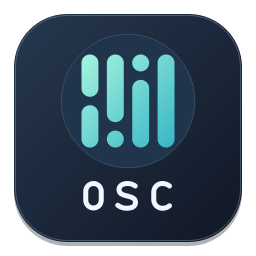

<h1 align="center">MpOsc</h1>

**Turn movement into live OSC.** Use a camera, a video, Syphon on macOS or Spout on Windows to play your visuals, sound and lighting with your face, hands and body. Tracking runs on your machine.

<!-- release-downloads:start -->
**LATEST VERSION · [v0.3.3](https://github.com/PixelStereo/MpOsc/releases/tag/v0.3.3)**

&nbsp;&nbsp;
<!-- release-downloads:end -->

On an **Apple Silicon Mac**, unzip and move MpOsc to Applications. On **Windows x64**, run the installer and launch MpOsc from the Start menu.

Choose a video source, enter your OSC destinations, click the signals you want, then turn on **Send OSC**. Select a signal and press **Cmd+M** (**Ctrl+M** on Windows) to shape it with a chain of filters: each filter has its own bar under it, and the signal as it comes in sits above them, so you see what every step does. In the table, the bar is the signal and the amber line under it is what gets sent. Hover anything to read what it does, at the bottom right.

Save your setup as a `.mposc` file to recall your settings later.

## Filter any signal

Every signal, whatever its type (a switch, a count, a measure), goes through its own chain of filters before it is sent and shown. Select a signal in the table and use **Add filter** at the right: invert, average, attack / release, delay, hold, debounce, auto return, envelope… The menu is grouped (Smooth, Time, Trigger, Shape), each filter with a line saying what it does; hover for when to use it, and its description stays on its card. Only the filters that mean something for the signal are offered; the ones over time suit them all. Drag a filter to change the order, fold it to hide its settings. Right-click a family (`/face/*`, `/hands/left/*`, `/hands/right/*`, `/body/*`) to give a filter, or the chain of the selected signal, to all of its signals. A badge `≋ 2` marks the signals that have filters. The filters are those of [pxs-core](https://github.com/PixelStereo/pxs-core), run and edited through [pxs-qt](https://github.com/PixelStereo/pxs-qt), and are saved in the `.mposc` file.

The filtered value is what goes out: `T` / `F` for a switch, `i` for a count, `f` for a measure, and what an OSCQuery client sees.

## Drive it from anywhere

MpOsc is an OSCQuery device like every other Pixel Stereo application: it announces itself on the network, and any OSCQuery client (Ossia Score, Chataigne, Kadran, your own script) finds it, reads its tree and drives it. Ports **47821** (OSC) and **47822** (OSCQuery), or the next free ones.

| Address | What |
|---|---|
| `/osc/send`, `/osc/destinations` | arm the output, say where it goes |
| `/detection/confidence`, `/detection/tracking`, `/detection/hands` | the detection thresholds |
| `/analysis/size` | the size of the copy the detection runs on |
| `/tracking/face`, `/tracking/hands`, `/tracking/body` | what to track |
| `/preview/mirror`, `/preview/landmarks` | the preview |
| `/video/stop`, `/video/camera/start` | the source |
| `/face/…`, `/hands/…`, `/body/…` | every signal MpOsc sends, listed so you know what to map |

Writing an address does exactly what a click does.

Built by Pixel Stereo. Building from source? Initialize SDKs with <code>git submodule update --init --recursive</code>, then run <code>./build.sh</code>. Requires Qt 6, CMake, a C++17 compiler, and Python with <code>uv==0.9.28</code>.

## License

AGPL-3.0, see [LICENSE](LICENSE).
