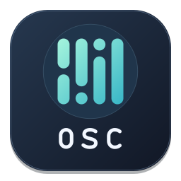

<h1 align="center">MP_OSC</h1>

**Turn movement into live OSC.** Use a camera or a video to play your visuals, sound and lighting with your face, hands and body. Tracking runs on your machine.

<!-- release-downloads:start -->
**[Download Mac](https://github.com/PixelStereo/MP_OSC/releases/download/v0.1.0/MP_OSC-macos-arm64.zip)** · **[Download Windows](https://github.com/PixelStereo/MP_OSC/releases/download/v0.1.0/MP_OSC-Windows-x64-Setup.exe)**
<!-- release-downloads:end -->

On an **Apple Silicon Mac**, unzip and move MP_OSC to Applications. On **Windows x64**, run the installer and launch MP_OSC from the Start menu.

Choose a video source, enter your OSC destinations, click the signals you want, then turn on **Send OSC**. Save your setup as a `.mposc` file to recall your settings later.

Built by Pixel Stereo. Building from source? Run <code>./build.sh --help</code>. Requires Qt 6, CMake, a C++17 compiler, and Python with <code>uv==0.9.28</code>.
